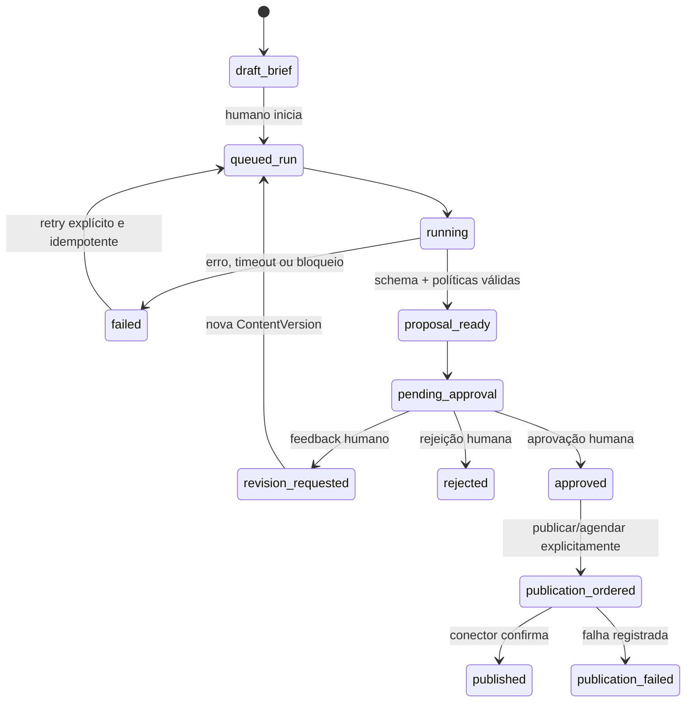

# Especificação da Camada de Agentes de Marketing

**Status:** proposta de referência para a próxima etapa de desenvolvimento  
**Data:** 2026-08-07  
**Escopo:** módulo `backend/app/modules/agents` e sua experiência no frontend

## Decisão de produto

A camada `agents` é o workspace de **marketing assistido** da LGD Mantos: converte um objetivo comercial em proposta de campanha baseada em dados internos, gera copy e direção criativa, conduz revisão humana e registra a publicação.

Ela não é um assistente genérico do sistema. `operational` continua sendo a fonte de verdade transacional; `analytics`, a fonte de verdade analítica; e `agents` só lê seus contratos públicos e grava artefatos próprios de marketing.

Para cada campanha, o dono deve conseguir verificar: o problema comercial tratado; os dados, documentos de marca e regras utilizados; a versão exata aprovada e o responsável; e o resultado de publicação.

## Base atual: fatos e lacunas

| Descoberta | Classificação | Evidência |
|---|---|---|
| Pipeline `Data → Strategy → Content → Creative` persiste campanha, post, briefing e aprovação. | Implementada | `agents/supervisor/service.py`, `agents/agents/*.py` |
| Vendas, estoque, margem e qualidade chegam via Analytics sem escrita em Operacional. | Implementada | `analytics/services/agent_context_service.py`, Supervisor |
| Há aprovação, rejeição e pedido de revisão humanos. | Implementada, mas sem identidade real | `agents/approval/service.py`, PolicyEngine |
| Revisão injeta feedback e cria nova aprovação. | Implementada | `agents/approval/routes.py`, Supervisor |
| Campanha aprovada pode entrar em fila e ser marcada manualmente como publicada. | Implementada | `agents/publishing/*`, `marketing_ops/models.py` |
| Meta/Instagram real, agendamento e provedor LLM externo não estão implementados. | Não evidenciada | `agents/config.py`, `agents/publishing/*` |
| Execução usa `BackgroundTasks`; restart pode deixar run em `running`. | Implementada; risco conhecido | Rotas/Supervisor e plano histórico |
| Revisão atual sobrescreve `Post` e `CreativeBrief`; não há histórico nem snapshot aprovado. | Implementada; lacuna | Supervisor e `marketing_ops/models.py` |

Esta especificação orienta as próximas decisões de produto para o módulo Marketing.

## Princípios inegociáveis

1. **Marketing, e só marketing:** IA não altera estoque, preço, vendas, catálogo, despesas ou Analytics.
2. **Dados antes de geração:** toda recomendação deve ter contexto e evidência persistidos.
3. **Humano decide:** IA propõe; pessoa autenticada aprova, revisa, rejeita, agenda ou publica.
4. **Sem fatos inventados:** preço, desconto, disponibilidade, prazo e alegação comercial exigem fonte verificável.
5. **Histórico completo:** contexto, conteúdo, validações, feedback, decisão e publicação devem ser rastreáveis.
6. **Falha segura:** dúvida ou falha bloqueia a campanha; nunca equivale a aprovação/publicação.
7. **Contratos claros:** `agents` usa APIs/serviços públicos de Analytics, sem acessar ou mutar Operacional diretamente.

## Papéis da camada

| Papel | Responsabilidade | Limite |
|---|---|---|
| Dono/marketing manager | Cria brief, revisa, aprova, rejeita e dá a ordem de publicação. | Toda decisão fica associada à sua identidade. |
| Data Agent | Seleciona oportunidades e riscos a partir de dados fornecidos. | Não altera dados nem afirma causalidade não medida. |
| Strategy Agent | Propõe uma campanha para um produto principal. | Não inventa SKU, preço, estoque, promoção ou canal habilitado. |
| Content Agent | Gera copy, CTA e variações no tom da marca. | Não define condições comerciais, aprova ou publica. |
| Creative Agent | Gera direção visual, roteiro e uso de fotos existentes. | Não gera/publica assets sem autorização humana. |
| Orquestrador | Executa etapas, valida e encaminha. | Não toma decisão de negócio ou contorna políticas. |
| Policy Engine | Aplica regras determinísticas. | Não usa LLM nem cria exceções. |
| Publicador/conector | Executa ordem humana e registra a resposta do canal. | Não publica automaticamente. |

`Approval`, `Publishing` e `Ops` são serviços de domínio; não devem ser chamados de agentes LLM, pois não têm autonomia de decisão.

## Modelo de domínio alvo

Os modelos existentes são uma boa base, mas a próxima evolução precisa explicitar os seguintes conceitos:

| Entidade | Responsabilidade | Regra essencial |
|---|---|---|
| `MarketingBrief` | Pedido humano com objetivo, produto opcional, canais/formatos, restrições e prazo. | Imutável após iniciar; alteração cria revisão. |
| `AgentRun` | Execução técnica de um brief. | Tentativa, etapas, timestamps, erro seguro e correlação. |
| `ContextSnapshot` | Dados, knowledge, modelo, prompt e políticas usados. | Persistido com o run; nunca reconstituído silenciosamente. |
| `CampaignProposal` | Estratégia: produto, razão, canal, formato, ângulo, CTA e risco. | Um produto principal no MVP. |
| `ContentVersion` | Pacote imutável de copy e direção criativa de uma rodada. | Revisão cria versão, nunca sobrescreve aprovada. |
| `ValidationReport` | Resultado de schema e políticas. | Bloqueio impede aprovação/publicação. |
| `ApprovalDecision` | Decisão sobre versão específica. | Guarda autor, papel, comentário, data e versão-alvo. |
| `PublicationOrder` | Ordem humana de publicar/agendar. | Só para versão aprovada e ainda válida. |
| `PublicationAttempt` | Tentativa idempotente no canal. | Guarda ID externo, resposta sanitizada e erro. |
| `KnowledgeDocument` | Referência de marca, persona, regras e visual. | Tem versão, autoria, vigência e estado ativo. |

Compatibilidade: `Campaign` pode evoluir para `CampaignProposal`; `Post` e `CreativeBrief` devem receber uma chave de versão; `Approval` deve apontar para a versão, não apenas para a campanha.

## Fluxo desejado

Regras de fluxo:

- Um run propõe no máximo uma campanha no MVP. Múltiplas campanhas ficam para evolução.
- Produto pode ser indicado no brief; sem indicação, Data/Strategy escolhem apenas um produto elegível.
- Falta de dados ou de knowledge aparece como risco. Falta de regra comercial bloqueia a alegação correspondente.
- Revisão sempre preserva a versão anterior e exige nova aprovação.
- Rejeição encerra a proposta; reabertura exige novo brief ou duplicação explícita.
- Aprovação expira se conteúdo, produto ou condição relevante mudar. Publicação revalida estoque e elegibilidade.

## Requisitos funcionais

### Brief e execução

- **FR-01:** criar brief estruturado com objetivo, produto opcional, canal/formato, instruções, prazo e referências; objetivo livre não será a única entrada.
- **FR-02:** validar campos, produto ativo, canal suportado e permissões antes de enfileirar.
- **FR-03:** salvar snapshot analítico, documentos usados, versão de prompt/políticas e modelo/provedor.
- **FR-04:** exibir estado por etapa (`context`, `data`, `strategy`, `content`, `creative`, `validation`, `approval`), duração e erro seguro.
- **FR-05:** retry é explícito, preserva histórico e não duplica artefatos ou publicação.

### Geração e validação

- **FR-06:** apenas produto ativo e com estoque positivo é elegível; estoque crítico bloqueia ou exige confirmação conforme política.
- **FR-07:** estratégia inclui justificativa e referências aos dados do snapshot.
- **FR-08:** copy e briefing criativo obedecem schema e limites por canal; variações são identificáveis.
- **FR-09:** preço, desconto, estoque e prazo citados precisam apontar para dados/autorização estruturados; sem fonte, bloqueio.
- **FR-10:** knowledge de voz, persona e regras comerciais é aplicado e sua ausência fica visível na revisão.

### Revisão, aprovação e publicação

- **FR-11:** feedback obrigatório gera nova `ContentVersion` e uma aprovação pendente vinculada a ela.
- **FR-12:** aprovar/rejeitar/revisar registra `user_id`, papel, data, comentário e versão; rejeição e revisão exigem comentário.
- **FR-13:** aprovação é diferente de publicação: publicar/agendar é uma ordem humana posterior que confirma canal, versão e horário.
- **FR-14:** conector usa chave idempotente, persiste ID externo e não republica após retry/timeout sem confirmação.
- **FR-15:** sucesso/falha registra motivo, resposta sanitizada, URL/ID externo e horário. Marcação manual é fallback auditado.

### Knowledge e operação

- **FR-16:** knowledge possui tipo, título, versão, autor, vigência e histórico. Tipos iniciais: `brand_voice`, `persona`, `commercial_rules`, `visual_guidelines`, `channel_guidelines`.
- **FR-17:** métricas incluem sucesso/duração por etapa, falhas, bloqueios, aprovações, revisões, publicações e uso por modelo.
- **FR-18:** resultado pós-publicação pode ser associado à campanha, mas não alimenta aprendizado automático sem regra/revisão humana.

## Regras de negócio e requisitos não funcionais

- **BR-01:** IA nunca escreve em Operacional ou Analytics.
- **BR-02:** desconto exige autorização humana estruturada com valor, escopo e validade; texto livre não basta.
- **BR-03:** produto sem estoque, inativo ou em condição crítica não é publicável.
- **BR-04:** processo, modelo ou conta de serviço não pode aprovar.
- **BR-05:** aprovação só vale para uma versão e snapshot de produto específicos.
- **BR-06:** canais permitidos são configuração de domínio, não texto produzido pelo Strategy Agent.
- **BR-07:** autopost é proibido; agendamento exige ordem humana prévia.
- **BR-08:** falha de integração nunca vira `published` por inferência.
- **BR-09:** regex é defesa complementar; regra crítica compara estruturas e snapshots.
- **BR-10:** provedor externo não recebe segredos ou dados pessoais desnecessários; modelo/provedor é registrado.

A camada deve executar jobs persistentes fora do processo HTTP, com timeout por etapa, retry limitado, retomada segura e detecção de abandono. Deve ter identidade/JWT e papéis reais, auditoria imutável, logs correlacionados por `run_id`, retenção configurável de prompts e respostas, e testes de políticas, workflow, transições, invalidação, versionamento, idempotência e conectores fake.

## MVP recomendado

Incluído:

1. Brief estruturado, job persistente, snapshot e relatório de políticas.
2. Os quatro especialistas atuais; uma campanha/um produto; Instagram como único canal alvo.
3. Versionamento real de conteúdo e revisão sem sobrescrita.
4. Aprovação com identidade/auditoria e revalidação de estoque.
5. Publicação manual assistida e registro de confirmação; Meta real só quando pré-requisitos forem fornecidos.
6. Métricas e testes de regressão.

Fora do MVP: autopost, descontos automáticos, várias campanhas no mesmo run, geração de imagem no backend, WhatsApp/TikTok, fine-tuning e aprendizado automático.

## Fases propostas

| Fase | Resultado verificável | Dependências |
|---|---|---|
| 0 — Contrato | Spec aprovada e decisões abertas respondidas. | Dono do produto |
| 1 — Fundação | Brief, job persistente, snapshot, identidade e versão de conteúdo. | Migrations e auth |
| 2 — Qualidade | Políticas baseadas em dados, relatório e UX de revisão. | Knowledge mínimo revisado |
| 3 — Publicação | Ordem humana, conector Instagram idempotente e auditoria. | Meta Business/app/token |
| 4 — Medição | Resultado associado à campanha e aprendizado supervisionado. | Dados externos |

## Critérios de aceite da próxima entrega

- Brief produz uma proposta rastreável ou falha com motivo claro.
- O frontend mostra dados/documentos/políticas usados, versões e status por etapa.
- Revisão preserva histórico e exige nova decisão.
- Aprovação tem identidade autenticada e perde validade após mudança relevante.
- Não se publica produto sem estoque, conteúdo não aprovado ou versão diferente da aprovada.
- Reinício não deixa run preso em `running`; ele é retomado ou classificado com segurança.
- Retry não duplica campanha, decisão ou envio.
- A suíte cobre políticas, estados, invalidação, versões, idempotência e conector fake.

## Decisões ainda necessárias

1. Estoque crítico: bloquear sempre, alertar ou permitir com confirmação explícita?
2. Descontos estarão no escopo? Quem os autoriza e por quanto tempo?
3. Quais métricas definem sucesso por objetivo: vendas atribuídas, DMs, alcance, cliques ou giro?
4. Quem além do dono aprova/publica e com quais papéis?
5. Próximo ciclo: Instagram real ou publicação manual assistida enquanto Meta é configurada?
6. Para LLM externo: teto de custo e dados que podem sair do ambiente?

Até essas respostas, as opções seguras são bloquear estoque crítico para publicação, não permitir desconto automático, manter aprovação do dono e usar publicação manual assistida.

## Impacto no código atual

| Área | Direção |
|---|---|
| `agents/supervisor` | Separar API de executor persistente; adicionar etapas, snapshot, retry e idempotência. |
| `agents/agents` | Manter quatro papéis; versionar prompts e exigir evidência estruturada. |
| `agents/marketing_ops/models.py` | Adicionar brief, snapshot, versões, decisão auditável e tentativas via migrations. |
| `agents/approval` | Trocar ator fixo `owner` por identidade e vincular decisão à versão. |
| `agents/publishing` | Evoluir marcação manual para ordem/tentativa; conector por interface. |
| `agents/knowledge` | Adicionar versão, autoria, vigência e referências por run. |
| `analytics` | Permanecer read-only; explicitar DTO de contexto e adicionar resultado pós-publicação depois. |
| `frontend/src/screens/mk` | Substituir objetivo livre por brief e expor evidências, versões e intenção de publicar. |
