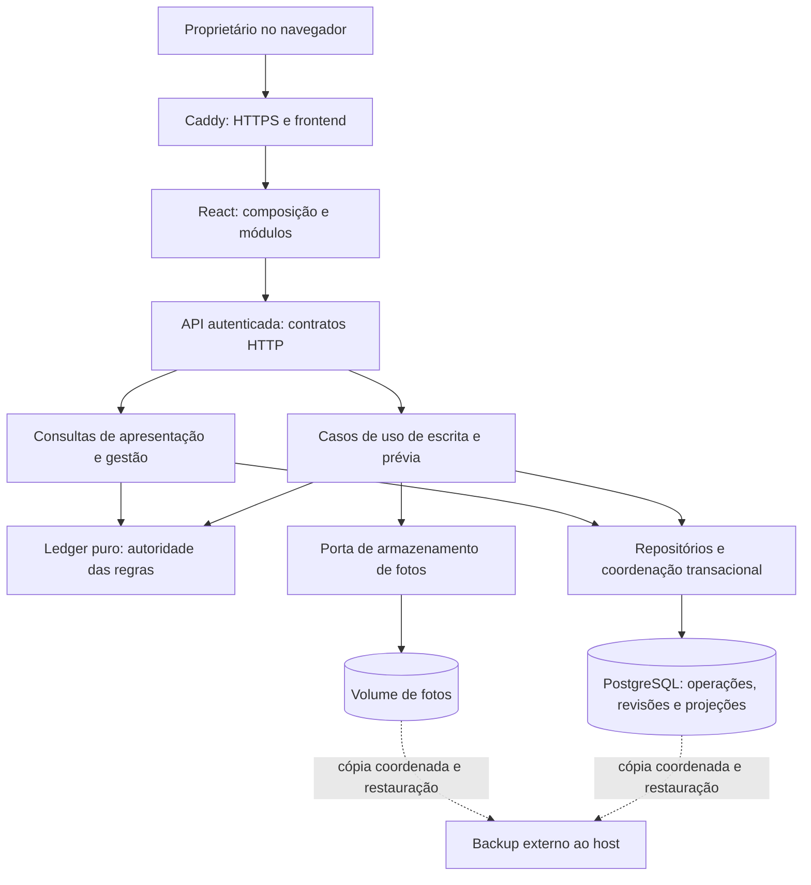

# Plano de melhorias — dimensão Arquitetura

Data: 2026-11-09. Status: arquitetura de aplicação implementada e verificada; requisitos da implantação real ainda pendentes.
Base inspecionada: `f67c59e` (`main`), após a entrega de Código em `6d8b98c`.

Fonte normativa: [Produto e objetivo](PRODUTO_E_OBJETIVO.md). Contratos vigentes: [Alinhamento implementado](ALINHAMENTO_IMPLEMENTADO.md). Acompanhamento: [Qualidade e situação atual](QUALIDADE_SITUACAO_ATUAL.md). A conclusão de C0–C8 permanece registrada no [resultado de Código](QUALIDADE_CODIGO_RESULTADO.md).

## Objetivo e limites

Consolidar um desenho simples, consistente, recuperável e mensurável para o acesso único do dono. O resultado esperado é que cada fluxo tenha autoridade de dados, fronteira transacional, política de leitura, comportamento de falha e limite de capacidade documentados e verificados.

O desenho proposto mantém frontend React, API FastAPI como monólito modular, PostgreSQL e armazenamento local de fotos no deploy de VPS único. A organização por capacidade entregue em Código é a base. Não há necessidade demonstrada de microserviços, mensageria, outro banco ou separação física dos módulos.

Esta etapa planeja arquitetura de aplicação e seus requisitos operacionais. Modelagem, constraints, índices, UUID/JSONB e normalização continuam na dimensão Banco. Se uma solução escolhida exigir schema, essa dependência deverá ter plano de migração, validação e recuperação antes da implementação correspondente. Novas integrações e capacidades comerciais dependem de decisão de produto e consumidor concretos.

O documento preserva o roteiro de execução. As soluções escolhidas, medidas, testes e limites estão no [resultado de Arquitetura](QUALIDADE_ARQUITETURA_RESULTADO.md). Alternativas condicionais não foram aplicadas automaticamente. O desenho de backup externo continua sendo requisito da implantação real.

## Situação da execução

| Etapas | Situação |
|---|---|
| A0 | Baseline local/remota e três escalas medidas; perfil real ainda desconhecido pelo dono |
| A1–A5 | Implementadas e verificadas; coleta/alertas no servidor continuam em OPS-03 |
| A6 | Replay integral mantido; carga e persistência otimizadas, limites publicados e acompanhamento em ARQ-11 |
| A7 | Fotos e reconciliação implementadas e verificadas, incluindo interrupção e commit incerto |
| A8 | Navegação/JWT mantidos por decisão documentada; limite de tentativas de login e recuperação verificados |
| A9 | Ferramentas e ensaio sintético de release/backup/restauração entregues; OPS-01/02/03 reais permanecem abertos |

As seções seguintes descrevem o plano original e os critérios utilizados; a implementação efetiva e suas diferenças estão no resultado. Não há alegação de capacidade ilimitada, SLA acordado ou prontidão operacional real.

## Evidências da arquitetura atual

| Evidência conferida nos arquivos atuais | Consequência e trabalho necessário |
|---|---|
| `backend/main.py` compõe roteadores por capacidade; `modules/operations/domain/ledger.py` concentra replay puro | Preservar a composição e uma única implementação das regras de estoque/custo; não duplicar cálculo em relatórios ou SQL |
| `operations/service.py::_execute()` é usado por prévia e confirmação; ambos chamam `shared/persistence/base.py::lock()` | A prévia também serializa com gravações. Medir separadamente prévia, confirmação e correção; não presumir que a prévia é uma leitura sem efeitos: a trava pode criar `Control` |
| `_execute()` carrega operações, bloqueia todas as variantes em ordem, reproduz o histórico e compara resultados | Custo cresce com histórico/variantes e correções podem atualizar operações posteriores. Ainda não há evidência de gargalo real |
| `management/service.py::report()` adquire `read_lock()`, carrega catálogo/operações e faz replay e cálculos antes de terminar a requisição | Há coerência sob trava compartilhada, mas o tempo de cálculo pode prolongar bloqueio de gravações |
| `core/database.py::get_db()` faz commit/rollback ao encerrar a dependência; fotos possuem commits explícitos | É preciso definir quem controla cada transação e onde terminam as travas; evitar introduzir commits intermediários no núcleo operacional |
| `catalog/repository.py::products()` faz várias consultas sem a trava compartilhada da gestão | Consistência entre produtos, variantes e fotos durante escrita concorrente precisa de contrato e teste; não há corrupção comprovada |
| `/operations`, `/movements` e catálogo retornam coleções integrais; `frontend/src/modules/history/api.ts` filtra movimentos no navegador | Separar consultas de apresentação do histórico completo necessário ao replay; começar pelo recorte de movimentos por origem |
| `photos/service.py` grava arquivo antes de confirmar metadados, compensa exceções e remove arquivo após commit; falha de remoção é ignorada | A compensação atual não cobre atomicamente interrupção do processo. É necessário observar e reconciliar referências/arquivos |
| `frontend/src/modules/photos/actions/replace.ts` substitui por upload → organização → exclusão em três requisições | Uma interrupção pode deixar as duas fotos ou organização parcial; especificar recuperação/repetição antes de mudar o fluxo |
| `management/service.py` importa diretamente `operations.domain.ledger`; módulos usam modelos ORM compartilhados | Modularização existe, mas propriedade e interfaces entre capacidades ainda precisam de política completa. Compartilhar ORM no monólito pode ser uma decisão válida |
| `frontend/src/shared/api/http.ts` importa a sessão de `modules/auth`; o gate frontend limita UI e imports entre módulos, mas não toda a direção de dependências | Registrar a exceção ou inverter a dependência pela composição da aplicação; não declarar independência de `shared` que o código não oferece |
| `backend/check_boundaries.py` verifica HTTP/domínio e infraestrutura em rotas, mas não contém matriz completa entre módulos nem detecção de ciclos | Ampliar a proteção conforme o desenho escolhido, com exemplos permitidos/proibidos e exceções explícitas |
| `system/service.py::health()` informa `status=ok` mesmo quando `database=error`; `/` informa apenas processo ativo | Distinguir vivacidade de prontidão e definir qual sinal o monitor consome; HTTP 200 isolado não comprova banco disponível |
| `docker-compose.prod.yml`, `deploy/Caddyfile` e `Dockerfile` descrevem uma VPS, volumes e migração no startup | Implantação é uma configuração existente, não evidência de backup restaurável, rollout validado ou disponibilidade |

Na fase de planejamento, a inspeção foi estática, apoiada nas documentações e nos arquivos citados. O grafo local apontava para caminhos anteriores à modularização e não foi usado como autoridade. Na execução posterior, testes, pipeline baseline, medidas e ensaio Docker isolado foram realizados conforme o resultado; nenhuma implantação real foi alterada.

## Desenho de referência proposto

O diagrama é a referência para o plano; backup externo é requisito proposto, ainda não implantado. Comandos e consultas são responsabilidades dentro da mesma API e do mesmo banco, sem serviços novos. Consultas de gestão podem usar o ledger; listagens simples não devem precisar recalcular estoque. PostgreSQL e fotos são dois recursos de persistência distintos.

### Propriedade e dependências

| Capacidade | Responsabilidade e autoridade | Contratos a consolidar |
|---|---|---|
| Auxiliares | Identidade, tipo, atividade e validação de referências; cada cadastro mantém entrada própria | Referências validadas e dados de consulta, sem expor regras específicas por helpers universais |
| Catálogo | Identidade de produto/variante, referência comercial e projeção de estoque visível | Consulta coerente de catálogo e acesso transacional às variantes; cadastro nunca altera saldo |
| Operações | Inventário, compra, venda, ajuste, pagamentos da venda, prévia, confirmação e correção | Candidato, replay, efeitos, versões e recibo; única autoridade das mutações operacionais |
| Histórico | Consulta de revisões e movimentos persistidos | Consulta por origem, ordem estável e rastreabilidade; não altera acontecimentos |
| Gestão | Cálculos descritivos e composição de evidências | Entrada coerente e identificável por revisão; nenhuma segunda regra de custo/estoque |
| Fotos | Metadados, vínculo, organização e ciclo de vida do arquivo | Porta de armazenamento, recuperação de falhas e substituição segura |
| Auth / sistema | Acesso do dono e sinais de disponibilidade | Contratos de sessão, erros, vivacidade e prontidão |
| Composição / compartilhado | Configuração, HTTP, persistência e primitivas comuns | Sem acumular coordenação de negócio; exceções de dependência explícitas |

Camadas: HTTP adapta entrada/saída → aplicação coordena o caso de uso → domínio calcula regras puras; infraestrutura implementa persistência e arquivos. Não é necessário criar uma interface para cada função. Interfaces públicas entre módulos serão pequenas e justificadas por consumidores reais. O uso compartilhado de modelos ORM deve ter responsáveis e restrições de escrita documentados, sem exigir sua distribuição física nesta rodada.

### Garantias que todas as decisões devem preservar

- Operações válidas ordenadas por instante efetivo e sequência são a fonte reconstruível do estoque/custo. Resultados e saldos persistidos são projeções, não entradas independentes para inventar estado.
- A confirmação mantém operação, recálculos posteriores, movimentos, auditoria, projeções, revisão global e recibo idempotente na mesma transação.
- Prévia não reserva estoque. Confirmação revalida a base e a assinatura; conflito exige nova revisão, preservando o formulário.
- Repetição de confirmação com mesma chave/conteúdo retorna o recibo; chave com outro conteúdo é conflito. Falha incerta não autoriza gerar automaticamente outra chave.
- Correções retroativas, anulações, nomes/preços capturados, pagamentos estáveis, custo desconhecido e precisão decimal continuam conforme o produto.
- Nenhuma otimização pode aplicar paginação ou filtro ao histórico de que o replay precisa para calcular corretamente.
- Erros continuam visíveis e recuperáveis; indisponibilidade não pode aparecer como lista vazia, estoque zero ou gestão calculada sobre dados parciais.

## Plano de execução

Cada etapa produz evidência própria. IDs A0–A9 identificam entregas deste plano; ARQ/BD/OPS/VER identificam pendências do registro central. Etapas condicionais devem terminar com decisão fundamentada de executar ou manter, nunca com implementação automática da alternativa.

### A0 — Linha de base e perfil de uso

Relaciona VER-01 e ARQ-01–04. Pré-requisito de decisões de capacidade.

1. Conferir pipeline remoto do SHA que será usado como baseline e registrar jobs/artefatos. Falha deve ser classificada e resolvida ou explicitamente bloqueada antes de usar a baseline como evidência.
2. Preparar ambiente isolado e reproduzível, apenas quando iniciar execução: PostgreSQL de teste, fotos temporárias, versões da stack e configuração de CPU/RAM/disco. Não recriar Docker como parte desta atualização documental.
3. Registrar expectativa de catálogo, variantes, operações/dia, itens/pagamentos por operação, retenção, dispositivos/abas simultâneos e necessidade de navegação por URL. Ausência de informação vira hipótese identificada, não capacidade prometida.
4. Gerar dados sintéticos determinísticos em três escalas. Proposta inicial para investigação: 1 mil, 10 mil e 50 mil operações, variando quantidade de variantes e tamanho dos documentos; ajustar ao perfil informado. Incluir lacunas de custo, pagamentos parciais e correção antiga com muitos dependentes.
5. Medir prévia, confirmação, correção no início/meio/fim, catálogo, movimentos e gestão. Separar aquecimento e execuções medidas; registrar número de amostras, mediana, p95, erros, memória, payload e configuração.

Saída: relatório de baseline, gerador/comandos reproduzíveis e envelope de uso. Metas provisórias para discussão: p95 de consultas usuais até 1 s, prévia/confirmação até 2 s e relatório/correção extensa até 5 s na escala de referência. São metas propostas, não desempenho medido nem SLA aprovado; fixar os valores e a escala antes de comparar soluções. Correção excepcional pode ter limite distinto com justificativa e comportamento de espera definido.

### A1 — Sinais e limites de execução

Relaciona OPS-03, ARQ-01–03 e ARQ-09. Depende de A0 para o contexto de carga.

Instrumentar identificação de requisição, duração/status por rota, espera e tempo de retenção da trava, tempo de carga/replay/persistência, contagem de registros e falhas de armazenamento. Contar operações de prévia separadamente das confirmações e separar replay puro de sua carga de dados. Métricas não devem usar IDs de entidades como rótulos de cardinalidade ilimitada.

Definir tratamento de timeout de consulta/trava e de resposta perdida. A interface deve indicar tentativa em andamento e oferecer recuperação coerente com idempotência. Não acrescentar repetição genérica de POST/PUT nem cancelar cegamente uma confirmação que pode ter sido persistida. Avaliar limites com a mesma configuração de aplicação, pool e proxy usada na medição.

Definir vivacidade (processo) e prontidão (dependências necessárias), consumidor do sinal, códigos HTTP/corpo e compatibilidade da evolução de `/health`. Validar banco indisponível, timeout e recuperação. Não registrar senha, JWT, chave idempotente bruta, conteúdo integral da operação ou imagem nos logs. Uma plataforma externa de observabilidade só entra se necessária; logs estruturados e relatório de medidas podem atender a primeira rodada.

Aceite: diagnóstico identifica onde a latência ocorre e distingue API viva de API pronta; teste de indisponibilidade não indica prontidão falsa. Instrumentação tem custo medido e não muda os contratos de negócio.

### A2 — Fronteiras e contratos entre capacidades

Relaciona ARQ-06. Pode avançar junto de A1 após a baseline.

Documentar matriz de imports e propriedade de escrita usando a tabela de capacidades; mapear os acessos reais a modelos compartilhados. Definir API pública para o cálculo do ledger consumido por Gestão, evitando dependência de implementação interna. Resolver a direção `shared/api` → `auth/session` com injeção da sessão na composição ou exceção pequena, explícita e testada; escolher pela simplicidade do resultado.

Expandir o gate backend para a matriz escolhida e ciclos, com testes que demonstrem violações recusadas e imports válidos aceitos. Ajustar o gate frontend somente para regras efetivamente escolhidas, preservando contratos públicos e os cadastros auxiliares separados. Separar dependências de tipo quando aplicável; impedir que uma exportação pública vire acesso irrestrito ao módulo inteiro.

Aceite: mapa de dependências corresponde ao código, violações novas falham no CI e não há duplicação de regra nem mudança de comportamento. Não expandir esse trabalho para uma nova refatoração geral de diretórios.

### A3 — Transações, prévia e concorrência

Relaciona ARQ-02, ARQ-03 e ARQ-07. Depende de A0–A2.

Descrever a unidade de trabalho por caso de uso: início, trava, dados lidos, mutações, flush, commit, rollback e efeitos após commit. Tornar explícita a interação entre `get_db()` e commits de fotos. Testar a fronteira persistida real, incluindo erros de commit, não apenas retorno do serviço.

Medir cenários simultâneos: duas vendas da última unidade; correção durante confirmação; duas confirmações com a mesma chave; catálogo/foto alterado entre prévia e confirmação; gestão longa contra escrita; várias prévias em abas distintas. Registrar bloqueios, espera e resultado final, inclusive recibo e auditoria.

Primeira opção: manter serialização global se atender ao envelope. Se falhar, avaliar reduzir trabalho dentro da trava e separar a leitura coerente da prévia, sempre revalidando na confirmação. Alterar granularidade por variante só após demonstrar tratamento de operações com vários itens, correções que propagam efeitos e revisão global. Uma trava menor isoladamente não prova correção.

Aceite: política transacional única por fluxo, concorrência sem venda excedente/efeito duplicado, ordem de aquisição documentada, resposta a timeout definida e metas acordadas atendidas ou limitação de capacidade explícita. Mudança em assinatura/revisão é decisão própria, com testes de incompatibilidade e plano de transição.

### A4 — Consistência das consultas e gestão

Relaciona ARQ-03 e ARQ-07. Depende de A3.

| Consulta | Contrato a estabelecer |
|---|---|
| Gestão | Catálogo, operações e revisão de uma mesma base; período não transforma estoque atual em estoque histórico |
| Catálogo detalhado | Produto, variantes e fotos coerentes em uma resposta; saldo não é reserva para uma futura venda |
| Lista de operações/movimentos | Ordem estável, vínculo de origem, filtros e comportamento diante de novas escritas |
| Fontes do formulário em requisições paralelas | Carga para edição é indicativa; a prévia/confirmação é que valida referências e disponibilidade |

Comparar manter trava compartilhada, capturar dados sob trava e liberar antes do cálculo puro, ou leitura em snapshot transacional. Cada opção deve explicar isolamento, ORM carregado, revisão associada, duração da transação e como impede misturar versões. Não retirar a trava apenas porque o método é GET. Não fazer replay/cálculo síncrono pesado bloquear desnecessariamente outras requisições: medir também responsividade do processo e avaliar execução fora do event loop se necessário, com custo de cópia e cancelamento conhecido.

Aceite: testes de leitura/escrita concorrentes demonstram ausência de mistura no contrato escolhido; gestão preserva totais, vínculos de origem e tratamento de custo desconhecido; tempo de retenção da trava é registrado antes/depois.

### A5 — Consultas orientadas ao uso e payloads limitados

Relaciona ARQ-04 e BD-03. Depende dos contratos de A4.

Inventariar tela → API → consulta → colunas/payload → volume. Priorizar filtro de movimentos por `operation_id` no servidor e consulta de produto por ID quando a tela só usa um produto. Avaliar evitar a montagem de catálogo por varreduras repetidas de variantes/fotos, mantendo o mesmo contrato de saída onde adequado.

Definir filtros, ordenação com desempate por ID e paginação das listagens que a baseline exigir. Documentar novos parâmetros, resposta, limites e comportamento ao inserir dados entre páginas; escolher cursor ou offset com justificativa. Entregar backend e frontend juntos ou com compatibilidade transitória explícita. Preservar consumidores que precisam de todas as opções de cadastro e os vínculos de origem nas seis visões de gestão.

O replay recebe uma consulta interna própria com todos os dados necessários. A resposta gerencial atual reúne várias visões: separar resumos/detalhes apenas se medição justificar, mantendo a revisão e os critérios de consistência comuns.

Aceite: redução de carga/payload demonstrada no cenário alvo, sem registros omitidos/duplicados na estratégia definida; contratos HTTP e jornadas preservados. Índices necessários são especificados com evidência para a dimensão Banco, não criados por pressuposto.

### A6 — Capacidade do replay e projeções

Relaciona ARQ-01 e BD-02/07. Depende das medidas de A0–A5.

Registrar decisão entre manter replay completo, otimizar carga/algoritmo ou introduzir checkpoint/projeção. Manter é aceitável se cumprir o envelope. Antes de novos mecanismos, examinar os dados carregados e trabalho repetido.

Se checkpoint/cache for necessário, detalhar chave e versão do algoritmo, revisão da base, instante/sequência cobertos, dados e variantes incluídos, invalidação por correção/anulação retroativa e recuperação após falha. Um checkpoint anterior ao ponto alterado só pode ser reutilizado quando sua validade estiver demonstrada. Dados derivados devem poder ser descartados/reconstruídos sem perder fonte ou auditoria; escrita/publicação da projeção precisa de fronteira de consistência explícita.

Aceite condicional: comparação com replay completo como oráculo em cenários gerados e correções no início/meio/fim, incluindo empates, pagamentos, custo desconhecido e variantes novas. Quantidades, custos, resultados, movimentos e impactos devem ser equivalentes. Sem mecanismo novo: relatório e limite de capacidade encerram a investigação. Projeção assíncrona com leitura eventualmente consistente exige decisão adicional; não integra o desenho padrão.

### A7 — Fotos: interrupção, substituição e reconciliação

Relaciona ARQ-08 e OPS-01/03. Pode avançar após A2/A3.

Especificar estados e falhas de upload, organização, exclusão e substituição. Cobrir interrupção entre escrever arquivo e commit, commit confirmado com resposta perdida, falha ao remover arquivo, substituição interrompida entre as três chamadas e arquivo ausente para metadado válido.

Escolher fluxo de substituição coordenado pelo backend ou recuperação explícita do fluxo atual, com regra de repetição e preservação da foto antiga até a nova estar utilizável. Não estender automaticamente `RequestReceipt` de operações a fotos sem definir seu contrato. Avaliar validação/gravação temporária fora da trava e promoção atômica no armazenamento local, sem alegar transação distribuída entre disco e banco.

Planejar reconciliação administrativa: primeiro inventário somente de leitura e relatório de órfãos/ausentes; depois eventual quarentena/limpeza com conferência, margem contra uploads em andamento e escopo estrito no diretório gerenciado. Não apagar arquivos ou registros no startup. Tornar falha de limpeza observável, preservando sucesso já confirmado no banco e evitando induzir o usuário a repetir uma exclusão concluída.

Aceite: injeção de falhas e interrupções demonstra estado recuperável, foto anterior protegida na substituição e nenhum arquivo de outro escopo removido. Restauração inclui banco e fotos relacionados. Limites de bytes, formatos, autenticação e vínculos permanecem.

### A8 — Navegação e fronteira de acesso

Relaciona ARQ-05 e ARQ-10. Pode avançar após A2.

Decidir necessidade de URL por tela, refresh preservando contexto, botão voltar do navegador e compartilhamento interno de um vínculo. Se manter pilha local, registrar limitações aceitas. Se evoluir, especificar rotas/IDs/parâmetros tipados, retorno após login e comportamento de rascunhos. Não persistir silenciosamente dados de formulário nem introduzir roteador sem necessidade demonstrada.

Registrar o modelo de acesso único atual: senha de ambiente, JWT de 30 dias em `localStorage`, segredo compartilhado para JWT e assinatura de prévia, fotos autenticadas e borda HTTPS. Avaliar duração/revogação de sessão, rotação de segredo, efeito sobre prévias pendentes, tentativas de login e exposição do token no navegador. Escolher controles proporcionais ao uso; cookies ou novos fluxos de autenticação dependem de análise de compatibilidade e riscos, sem introduzir multiusuário.

Aceite: decisões explícitas, cenários de expiração/401, refresh/back e rotação documentados e testados quando alterados. Manter arquitetura existente pode encerrar investigação com limites registrados. Esta análise delimita confiança e acesso; não substitui auditoria completa de segurança.

### A9 — Recuperação operacional e fechamento

Relaciona OPS-01–03 e todas as pendências ARQ. Depende das entregas aplicáveis anteriores.

Definir RPO/RTO, retenção, responsável e destino de backup fora do host. Escolher cópia consistente de banco/fotos: por exemplo, suspender escritas durante a captura ou documentar outro protocolo verificável. Restaurar em ambiente isolado e conferir operações, projeções, recibos, auditoria e fotos; registrar tempo e perda máxima possível. Não confundir teste em base sintética com comprovação de backup da implantação real.

Validar release com artefato identificado, migração controlada antes do tráfego, persistência dos volumes, HTTPS, configuração e recuperação. Avaliar retirar migração do startup para etapa administrativa explícita, ou justificar sua manutenção com exclusão mútua e comportamento de falha documentados. Rollback de imagem não equivale a downgrade de schema; dados gravados após a atualização precisam de estratégia própria.

Publicar desenho final, decisões, medidas antes/depois e limites. Atualizar `ALINHAMENTO_IMPLEMENTADO.md`, `DEPLOY.md`, README e registro central conforme a implementação real, mantendo rastreabilidade com este plano. Uma implantação continua com OPS aberto se o acesso ao ambiente e o ensaio necessários não ocorreram.

Aceite: checklist de release/recuperação exercitado no ambiente declarado, evidências referenciadas por SHA/configuração e nenhuma pendência sem destino. Dependências de Banco têm IDs, escopo e critério de aceite próprios.

## Sequência, decisões e critérios de conclusão

Sequência principal: A0 → A1/A2 → A3 → A4 → A5 → A6 → A9. A7 e A8 podem avançar após as respectivas dependências, sem executar suítes que compartilham banco simultaneamente. OPS-01 precede uso com dados reais, mesmo que as demais etapas ainda estejam em avaliação.

Cada decisão deve registrar: contexto e IDs envolvidos; evidência e hipóteses; opções comparadas; escolha e justificativa; consistência e falhas; custo operacional; compatibilidade/migração; recuperação; testes e critério para reconsiderar. Usar registros de decisão em `docs/decisions/` na execução, sem preencher resultados fictícios agora.

Para cada fatia implementada: verificar fronteiras/lint/build e testes pertinentes; mudanças transacionais exigem PostgreSQL isolado e concorrência real; mudanças de fluxo exigem jornada de interface. No fechamento, repetir a suíte completa e conferir CI remoto do SHA final. Os resultados históricos de 64 testes backend, 16 frontend e quatro jornadas E2E são referência anterior, não a contagem obrigatória ou evidência desta rodada.

Arquitetura só estará concluída quando:

- A0–A9 tiverem evidência de entrega ou decisão fundamentada de manter para itens condicionais.
- Toda necessidade identificada tiver solução verificada ou dependência explicitamente aberta em Banco/Operação; dependência aberta não pode ser apresentada como implementada.
- Contratos de consistência, transação e falha corresponderem ao código, e o envelope de capacidade tiver medição reproduzível.
- Regras de produto, idempotência, auditoria, correções e custo desconhecido continuarem verificadas.
- O relatório final distinguir arquitetura de aplicação concluída de prontidão operacional: OPS pendente impede declarar disponibilidade/recuperação comprovadas.

Baseline, decisões, implementação e verificações estão no resultado. O uso real deve orientar a reconsideração dos limites medidos; preparação da implantação e avaliação de Banco seguem acompanhadas no registro central.
